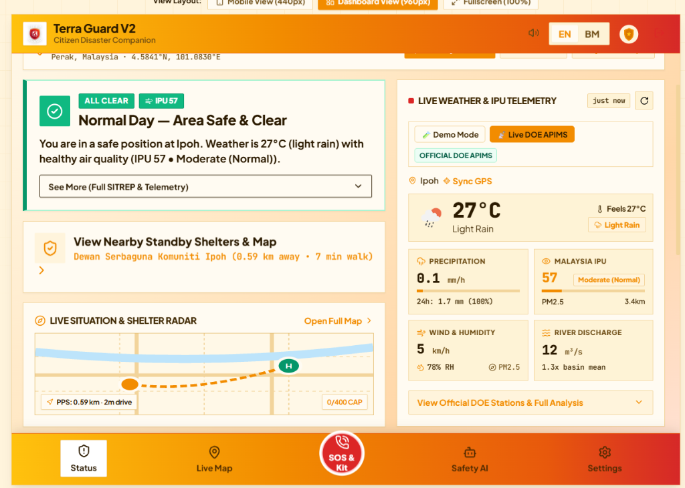

  

&nbsp;

&nbsp;

  

**Full-Stack Development · Cloud Fundamentals · System Utilities**

Passionate about building resilient, user-centered web applications, cloud backends, and tactical software utilities.

---

## ⚡ About Me

I am a 2nd-year **Information Technology** student at **Universiti Teknologi PETRONAS (UTP)** with an expected graduation in 2029. 

- 📍 **Location:** Ampang, Selangor, Malaysia
- 🎯 **Goal:** Actively seeking an internship opportunity in **Software Development** or **Cloud Engineering**
- 💡 **Focus Areas:** Full stack web development, cloud architectures, and dependable database systems
- 🚀 **Currently Exploring:** Diving into AWS cloud architecture and serverless development

---

## 🏆 Selected Work

### 🌟 [KAMPUSKash : Student Financial Tracker](https://github.com/airilakio29/KiroKash) `Flagship`
> A modern student personal finance management platform designed to track multi-account balances, daily campus expenses, category budgets, and savings goals in Ringgit Malaysia (RM) with real-time cloud synchronization. Began as 1st place hackathon winner KampusKash, continuously developed into a comprehensive finance tool.
>
> 
> 
> 
> 
<!-- Project preview placeholder: 

 -->

---

### 🚨 [Terra Guard V2 : Citizen Disaster Companion](https://github.com/airilakio29/terra-guard-v2) `Sime Darby Hackathon`
> **The user-centered evolution of Terra Guard.** Built as a direct response to jury feedback on the original *Terra Guard* (where evaluators noted that dense tactical command telemetry and radar gauges were too overwhelming and not user-friendly for stressed citizens). Re-engineered from the ground up as a mobile-first, cognitive-de-escalation Progressive Web App (PWA) with split-second risk tiers, 1-tap pre-composed triage chips with Web Speech ("Read Aloud") audio guidance, live PPS relief shelter navigation with capacity tracking, and 100% offline 72-hour survival tools.
>
> 
> 
> 
> 
> 
> 
> 
<!-- Project preview placeholder: 

 -->

---

### 🛡️ [Terra Guard (V1) : Tactical Disaster Utility](https://github.com/airilakio29/Terra-Guard) `Hackathon Finalist`
> The original tactical disaster monitoring platform that reached national hackathon finals. Delivered real-time spatial hazard mapping (active fire hotspots, weather radar, sensor grids), full bilingual (BM/BI) accessibility, and automated Situation Reports (SITREPs) synthesized by Gemini AI for emergency responders. Served as the technical foundation and critical design lesson that inspired Terra Guard V2.
>
> 
> 
> 
> 
> 
> 
<!-- Project preview placeholder: 

 -->

---

### 🏨 [Hotelier : Hotel Management System](https://github.com/airilakio29/Hotelier)
> A full-featured hotel operations and reservation platform providing digital guest bookings, automated facility add-on invoicing, staff shift scheduling, and an interactive color-coded live room status workspace. Deployed serverless on Vercel with community PHP runtime and cloud MySQL architecture.
>
> 
> 
> 
> 
> 
> 
> 
<!-- Project preview placeholder: 

 -->

---

## 🛠️ Capabilities

### Languages

### Cloud & Backend

### AI-Assisted Development & Tools

---

## 🏅 Recognition & Achievements

- 🥇 **1st Place Winner** — KrackedDev Build Day Mini Hackathon *(original KampusKash)*
- 🏅 **3× Hackathon Finalist** *(including Terra Guard national disaster utility)*
- 🎖️ **Sime Darby Hackathon** *(Terra Guard V2 — Citizen Safety Companion PWA)*
- 🎖️ **2× Hackathon Project Director**
- 🎓 **2× Dean's List Honoree** — Universiti Teknologi PETRONAS *(Information Technology)*

---

## 📊 GitHub Insights & Activity

  

---

### 🤝 Let's Connect & Build

Interested in collaborating, hiring for an internship, or discussing cloud & software projects?

&nbsp;

&nbsp;

